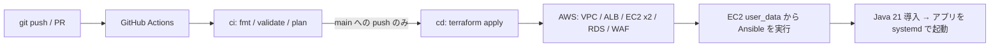
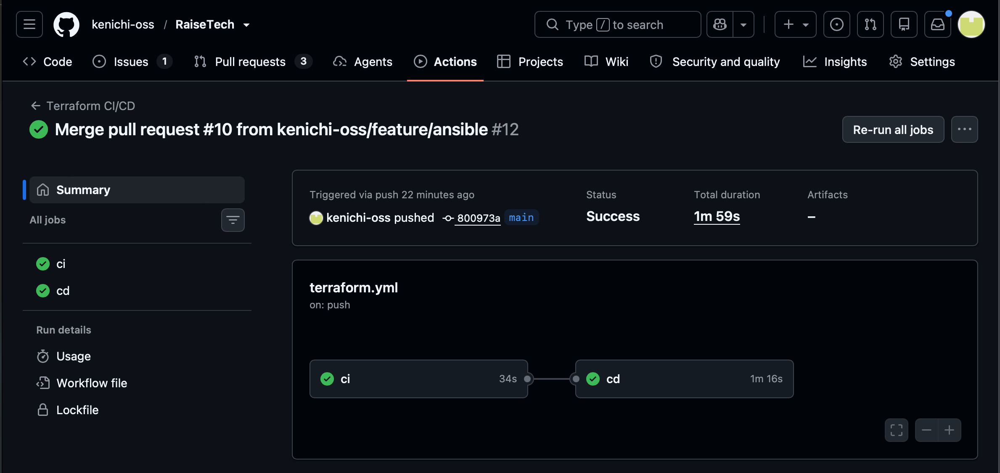
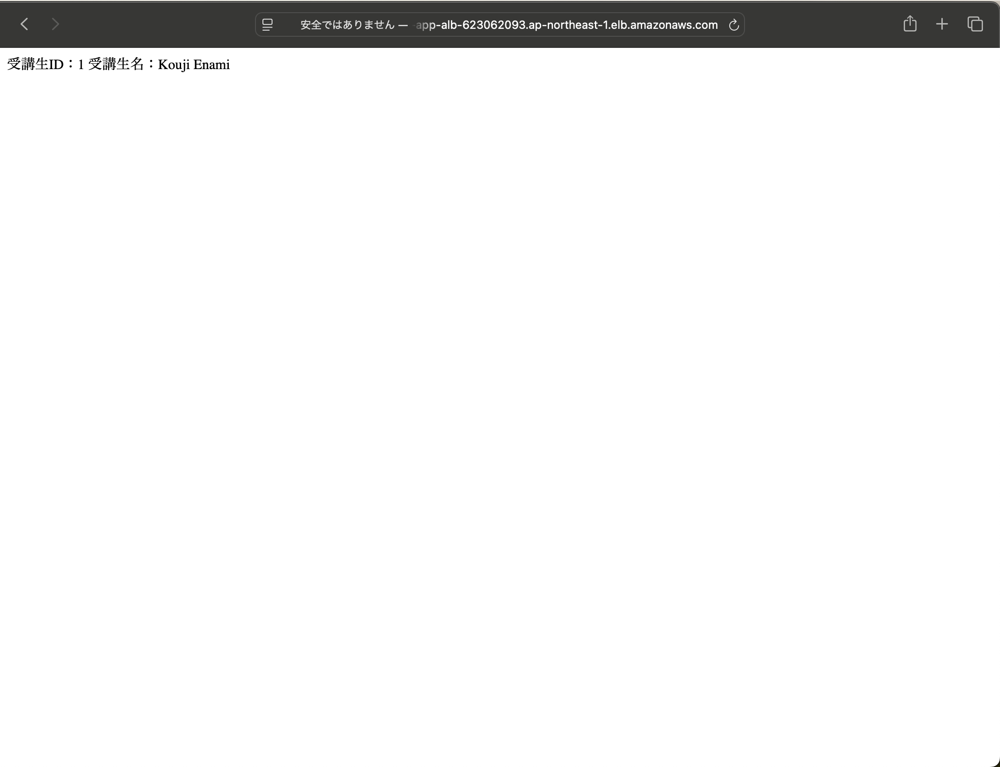
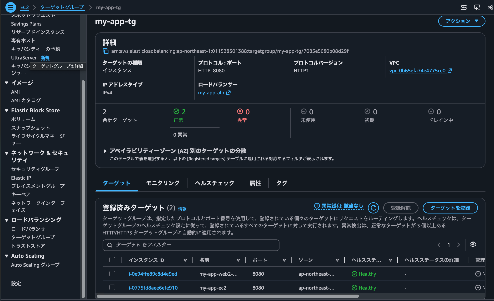

## 　実装内容
 - `git push` だけで、次のことを自動で行います。
1. Terraform のコードを検査する(CI)
2. AWS 上に、VPC / ALB / EC2 2台 / RDS / WAF などを構築する(CD)
3. EC2 の起動時に Ansible が動き、Java 21 を導入して、アプリを systemd で自動起動する

提出 PR: <https://github.com/kenichi-oss/RaiseTech/pull/9>
   
## 全体構成

## 使用技術
| 種類 | 内容 |
|---|---|
| IaC | Terraform ○○(AWS provider ~> 6.0)、state は S3 backend |
| 構成管理 | Ansible(EC2 自身に `ansible-playbook -c local` で適用) |
| CI/CD | GitHub Actions |
| AWS | VPC / EC2(Amazon Linux 2023) / RDS(MySQL) / ALB / WAF / CloudWatch / SNS |
| アプリ | Java 21(Amazon Corretto)、Spring Boot(Gradle) |
   
## ディレクトリ構成
```
.
├ .github/workflows/terraform.yml   CI/CD の定義
├ ansible/                          Ansible(playbook と roles)
│   └ roles/ (swap, java, app)
└ terraform-aws-study/              Terraform
    ├ envs/development/
    └ modules/ (vpc, security_group, iam, rds, ec2, alb, waf, monitoring)
```
## ポイント
 - ci は読み取り専用の IAM キー、cd は書き込み権限の IAM キー(GitHub Environment の Secrets)を使用
 - フォークからの PR には Secrets が渡らないため、ci の対象から除外
 - `terraform-aws-study/**`、`ansible/**`、ワークフローの変更が、push のトリガー

## 動作確認
### 1.  Actions の ci と cd が緑の図


### 2. PLAY RECAP


### 3. ALB の URL でアプリが表示された画面


### 4. ターゲットグループの healthy


### 5. 冪等性が担保されていることを確認
playbook を連続して2回実行し、2回目が `changed=0` になることを確認しました。


## 工夫した点、学んだこと
### 判定の基準は、実際の状態にする
当初は、`create.sql` を実行済みかを、**EC2 内の印のファイル**で判定していました。しかし EC2 は2台あり、**各台が自分の印を見て、それぞれ1回ずつ実行**したため、同じ RDS にデータが二重に登録され、アプリが 500 エラー(ALB は 504)になりました。
そこで、判定の基準を、各サーバーの内部状態ではなく、**共有リソースである DB の実際の状態**(テーブル数)に変更し、さらに `run_db_init` の変数で、初期化を行う EC2 を1台に限定しました。複数台が共有するリソースの初期化は、「誰が、何を見て判断するか」を、設計する必要があると学びました。

### Terraform との組み合わせ
playbook 全体のハッシュを user_data に埋め込み、`user_data_replace_on_change = true` としています。`ansible/` を変更して push すると、EC2 が作り直され、新しい内容が、まっさらな状態から適用されます。既存のサーバーに差分を当てる方式ではなく、**毎回、既知の状態から構築する方式**です。そのうえで、playbook 自体も冪等なので、デバッグのための手動再実行や、途中失敗後の再実行も、安全に行えます。

## つまずいたことと対処
| 事象 | 原因 | 対処 |
|---|---|---|
| plan が通るのに apply で SNS と RDS が失敗 | Secrets の名前が、ワークフローの参照と違い、値が空になった | 名前を合わせた。変数に `validation` を追加し、plan の時点で止める |
| CI で変数の値がない | `*.tfvars` が `.gitignore` で除外されていた | 秘密でない値の tfvars だけ、除外の対象から外した |
| CI の init が認証エラー | backend に `profile = "study"` を指定していた | 削除し、手元では `AWS_PROFILE` で切り替えた |
| 2台目で SSM パラメータが重複する | 名前が固定の文字だった | 名前を変数にし、既定値を元の名前にして、既存の EC2 に差分が出ないようにした |
| アプリが 500 / ALB が 504 | 2台が、同じ RDS に `create.sql` を実行し、データが二重に入った | 1台目だけが、空の DB のときに実行するように変更(`run_db_init`、テーブル数の確認) |
| EC2 が固まり、起動しない | t3.micro のメモリ不足(swap なし) | Ansible で swap を作成し、1台目を t3.small に変更 |
| SSM のターミナルが止まる | `systemctl status` のページャーが入力待ちになった | `--no-pager` を付ける |

## セキュリティ上の工夫
- CI 用(読み取り専用)と CD 用(書き込み)の IAM ユーザーを分け、どちらもコンソールのログインなし
- 書き込みキーは、GitHub Environment の Secrets に置き、ブランチを main に限定
- `permissions: contents: read` の最小権限、tfplan を artifact にしない(Public リポジトリのため)
- 秘密情報(DB パスワード、メール)は、GitHub Secrets から `TF_VAR_` で渡し、コードに書かない
- SSM Session Manager で EC2 に入る(22 番ポートを開けない)

## AI に聞いた今後の改善
- 長期のアクセスキーをやめ、OIDC による一時的な認証情報にする
- CD 用の権限を、必要なサービスだけに絞る
- DB パスワードを、user_data ではなく SSM パラメータストア(SecureString)で渡す
- ALB に HTTPS(ACM の証明書)を導入する
- 台数を、Auto Scaling Group で自動調整する
- `terraform test` で、設計書の値を CI で検証する

