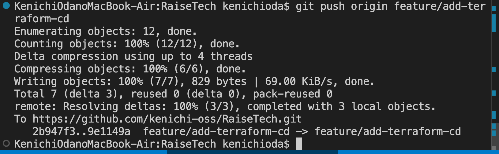
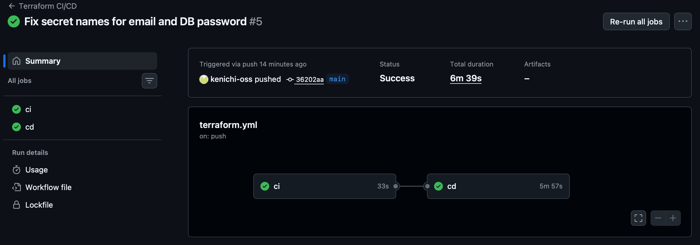
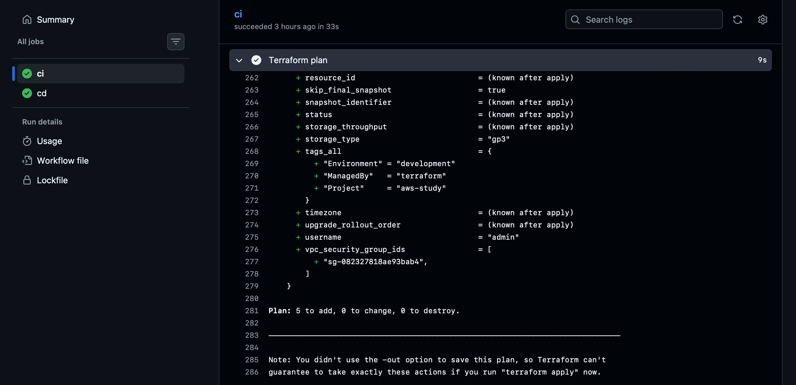
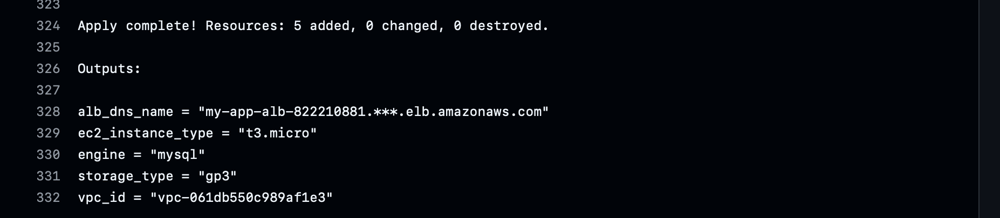
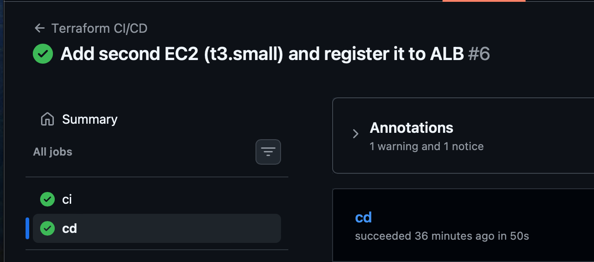
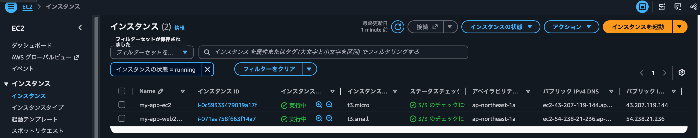

# 実装内容
# CI/CD 環境の構築(Terraform × GitHub Actions)

## 1. 概要
- main への push をきっかけに、自動でチェック(CI)し、成功したら自動でデプロイ(CD)する
- ワークフロー: [.github/workflows/terraform.yml](.github/workflows/terraform.yml)
- 成功した実行: <https://github.com/kenichi-oss/RaiseTech/actions/runs/41158451484>

## 2. CI/CD の流れ
| ジョブ | 内容 |
|---|---|
| ci | fmt → validate → plan(読み取り専用のキー) |
| cd | main への push で、ci 成功後に apply(Environment のキー) |

## 3. 証跡
### PUSH を実行。

### ci と cd が成功した実行

### plan のログ

### apply のログ

### EC2 を2台にして ALB に登録(t3.micro と t3.small)

## 4. 学んだこと
- CDの実装で、環境の再構築をする際、EC2を2台配置した結果、SSMパラメーターの名前が固定になっていて、エラーが出てしまっておりました。
理由としては、2回呼び出すことになった結果、同一の SSM パラメーターはすでに使用しているので、ParameterAlreadyExistsというエラーで apply で失敗しました。固定値を変数に変えることで、インスタンス 1つに対して一意のリソース名を作成することで解決しました。
ただ、リソース名を別の名前にする方法も考えましたが、この場合、既にあるEC2 を再作成しないといけなくなるという事象があるため、変数により修正を加えて、そのようなことにならないようにしました。
